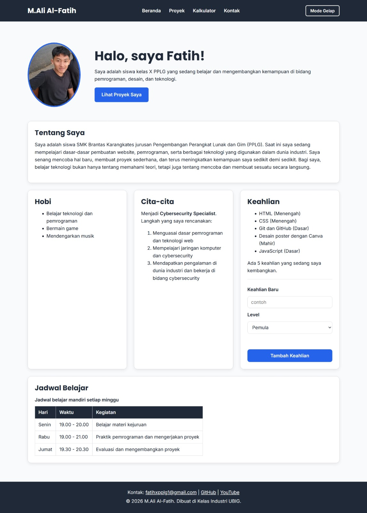

# Portofolio M.Ali Al-Fatih

Website portofolio pribadi yang saya buat di Kelas Industri UBIG
(Paket 1, Minggu 01 sampai 09).
Versi ini adalah **Portofolio v2**: tampil rapi di ponsel, tablet,
dan laptop, serta interaktif dengan JavaScript.

## Tampilan

## Fitur

- Halaman **Beranda** berisi profil, hobi, cita-cita, jadwal belajar,
  dan daftar keahlian dari `data/keahlian.json` yang bisa ditambah
  lewat form **Keahlian Baru** (nama keahlian dan level)
- Halaman **Proyek** berisi kartu proyek dari `data/proyek.json`
  dengan filter kategori, serta repositori GitHub terbaru dari GitHub API
- Halaman **Kalkulator** untuk perhitungan sederhana
- Halaman **Kontak** berisi form dengan penghitung karakter pesan
- Mode gelap di semua halaman
- Penanda menu pada halaman yang sedang dibuka
- Tampilan responsif dengan Flexbox dan *media query*
- Palet warna abu gelap dan biru dengan variabel CSS

## Teknologi

- HTML5 dan CSS3 (Flexbox, *media query*, dan variabel CSS)
- JavaScript (DOM, *event*, `fetch`, dan `async`/`await`)
- JSON dan GitHub REST API
- Git, GitHub, dan Vercel

## Skor Lighthouse (mobile)

- Beranda: Performance [ISI], Accessibility [ISI], Best Practices [ISI], SEO [ISI]
- Proyek: Performance [ISI], Accessibility [ISI], Best Practices [ISI], SEO [ISI]
- Kontak: Performance [ISI], Accessibility [ISI], Best Practices [ISI], SEO [ISI]

## Cara Menjalankan di Komputer

1. Unduh atau *clone* repositori ini.
2. Buka folder project di Visual Studio Code.
3. Klik kanan `index.html`, lalu pilih **Open with Live Server**.

## Tautan

- Website: https://tugas-harian-smkbrantas.vercel.app/
- Repositori: https://github.com/fatih4710/tugas-harian-smkbrantas
- Dibuat oleh: M.Ali Al-Fatih, SMK Brantas Karangkates